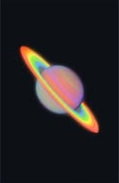

<table>
<tr>
<td colspan="2">

## Hey there! I'm Alan 👋

</td>
</tr>
<tr>
<td width="75%" valign="top">

**Space Tech & AI/ML Engineer** (Postgraduate, St Joseph Engineering College)

I'm deeply passionate about applying machine learning to astronomy and building engineering systems that handle real space data.

Currently, I'm focusing my energy on an **AI-enabled exoplanet detection pipeline** for **ISRO BAH 2026** with team *Orbital Pioneers*, and an **orbit crowding globe** that visualises satellites and debris. My playground revolves around Python, TensorFlow/PyTorch, data pipelines and visualisation.

</td>
<td width="25%" align="center">
  
</td>
</tr>
</table>

### 📌 Projects

<table>
<tr>
<td width="50%" valign="top">

**🪐 Exoplanet-Detection-Pipeline** `Public`

AI-enabled pipeline for detecting exoplanets, built for ISRO BAH 2026 (Challenge 7) with team Orbital Pioneers.

🔵 Python

</td>
<td width="50%" valign="top">

**🛰️ Orbit-Crowding-Globe** `Public`

A 3D globe visualising satellite and debris crowding in Earth orbit, built in a 6-hour hackathon.

🟡 JavaScript

</td>
</tr>
<tr>
<td width="50%" valign="top">

**🔐 RE-DACT** `Public`

Redaction and anonymisation tool prototype (Software, Blockchain & Cybersecurity track).

🔵 Python

</td>
<td width="50%" valign="top">

**➕ Your next project**

Add a short description here.

</td>
</tr>
</table>

### 🛠️ Tech Stack

### 📊 Stats

